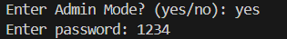
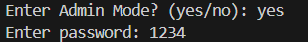
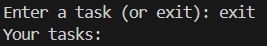

# Personal Task Manager

## Description

Personal Task Manager is a Python application for managing personal tasks. Users can add tasks, view their task list, and manage their tasks.

## Table of Contents

- [Features](#features)
- [Project Structure](#project-structure)
- [File Description](#file-description)
- [Requirements](#requirements)
- [Installation](#installation)
- [Environment Setup](#environment-setup)
- [Usage](#usage)
- [Example Output](#example-output)
- [Screenshot](#screenshot)
- [Roadmap](#roadmap)
- [Contributing](#contributing)
- [License](#license)
- [Author](#author)

## Features

- Get the user's name
- Add multiple tasks
- Display all tasks
- Save tasks locally
- Admin Mode with password protection

## Project Structure

```text
personal_task_manager/
├── main.py
├── tasks.py
├── requirements.txt
├── .env.example
├── .gitignore
├── README.md
├── pictures/
│   ├── 1.png
│   ├── 2.png
│   └── 3.png
└── gifs/
    └── demo.gif
```

## File Description

- `main.py`: Runs the main program.
- `tasks.py`: Contains task-related functions.
- `requirements.txt`: Lists required packages.
- `.env.example`: Shows the required environment variable.
- `.gitignore`: Specifies files Git should ignore.
- `pictures/`: Stores project screenshots.
- `gifs/`: Stores the demo GIF.
- `README.md`: Contains project documentation.

## Requirements

- Python 3
- Git
- python-dotenv

## Installation

1. Clone the repository:

   ```bash
   git clone YOUR_REPOSITORY_URL
   ```

2. Open the project folder:

   ```bash
   cd personal_task_manager
   ```

3. Install dependencies:

   ```bash
   pip install -r requirements.txt
   ```

## Environment Setup

1. Create a `.env` file in the project folder.
2. Add the following variable:

   ```text
   TASK_MANAGER_ADMIN_PASSWORD=your_password_here
   ```

3. Replace `your_password_here` with your test password.
4. Never upload your `.env` file to GitHub.

## Usage

Run the program:

```bash
python main.py
```

Follow the instructions displayed in the terminal.

## Example Output

```text
Enter your name: Yildiz
Welcome Yildiz
Enter a task or type exit: Learn Python
Enter a task or type exit: Practice Git
Enter a task or type exit: exit

Your tasks:
Learn Python
Practice Git
```

## Screenshot

### start


### quiz


### final



## Roadmap

- [x] Create the basic task manager
- [x] Add multiple tasks
- [x] Separate task logic into another file
- [x] Save tasks locally
- [x] Add Admin Mode
- [ ] Add task priorities
- [ ] Improve task management features

## Contributing

## License

## Author

Yildiz Bashiri